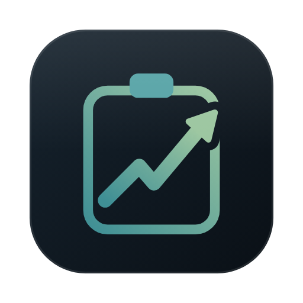

<div align="center">

<h1>
    <p>
        
    </p>
</h1>

# Clipkeep

**A private, local clipboard history for macOS — searchable, grouped by session, secrets kept out of sight.**

<code>copy</code> &nbsp;→&nbsp; <code>capture</code> &nbsp;→&nbsp; <code>encrypt</code> &nbsp;→&nbsp; <code>find again</code>


</div>

---

## ✨ What it is

Clipkeep lives in the menu bar and remembers what you copy. Copies are grouped into work sessions and topics, so you can find "that snippet from yesterday's Kubernetes debugging" instead of scrolling a flat list.

Everything stays on your Mac. There is no cloud, no account and no AI at runtime.

| | Feature | Notes |
|---|---|---|
| 🔎 | Palette | Global hotkey <kbd>⌃</kbd><kbd>⌥</kbd><kbd>V</kbd>, full-text search over your history |
| 🧾 | Snippets | Shell, SQL and YAML copies are collected with secrets replaced by placeholders; <kbd>⌃</kbd><kbd>⌥</kbd><kbd>S</kbd> opens the palette on them, and the snippet explorer in the menu lists them all with filters for language and topic and sortable columns. Save any entry by hand («Als Snippet speichern») or seed the collection once from the history, with the same anonymiser and filter («Snippets aus Verlauf übernehmen …») |
| 🗓️ | History window | Days, sessions and topics, entry detail, copy / pin / star / delete with undo |
| 🔐 | Secret handling | Detected secrets are moved to the Keychain; the history keeps only a placeholder |
| ⏸️ | Control | Pause capture, ignore apps, add content rules |
| 📥 | Import | Split a text file into entries, dated by its date headings («Textdatei importieren …»); an import can be deleted again («Import löschen …») |
| 📤 | Export | A session, a topic or a day as Markdown |
| 🧹 | Upkeep | Sessions, topics and ranking are maintained in the background |

---

## 🛠️ Build and run

Requirements: macOS 14 or newer and the Xcode Command Line Tools (full Xcode is not needed).

```bash
swift build                 # debug build
./scripts/bundle-app.sh     # release build, assembled as build/Clipkeep.app
open build/Clipkeep.app
```

A bundle is required for "launch at login". See [Installation](#-installation) for how the app is signed and installed.

To build a distributable zip and its SHA-256 checksum, run `VERSION=1.0.0 ./scripts/release.sh`. With a Developer ID certificate (`CODESIGN_IDENTITY`) it signs with the hardened runtime, and with a `notarytool` keychain profile (`NOTARY_PROFILE`) it also notarises and staples the app. See the header of the script.

| | Command | Purpose |
|---|---|---|
| 🔏 | `./scripts/create-signing-identity.sh` | Create the local code-signing certificate, once |
| 🧪 | `./scripts/test.sh` | Run the test suite (`-c release -Xswiftc -enable-testing` for release mode) |
| 🎨 | `./scripts/lint.sh` | Check formatting with swift-format (`--fix` rewrites files) |
| 📏 | `./scripts/eval.sh` | Search-quality evaluation, see [`eval/README.md`](eval/README.md) |

---

## 📦 Installation

Clipkeep is not notarised (there is no Apple Developer ID yet), so macOS shows a Gatekeeper warning the first time you open a downloaded copy. Two ways to install it:

### Download

1. Download `Clipkeep-<version>.zip` from the [latest release](https://github.com/JtheGunner/clipkeep/releases/latest) and unzip it.
2. Move `Clipkeep.app` to `/Applications`.
3. Right-click the app and choose **Open**, then confirm **Open** in the warning dialog. You only need to do this once. If macOS offers no **Open** button, go to System Settings → Privacy & Security and choose **Open Anyway**.
4. Grant the permissions the app asks for (see [Permissions](#-permissions)).

### Homebrew

```sh
brew install --cask JtheGunner/tap/clipkeep
```

The cask prints the same Gatekeeper note after the install. Remove the app with `brew uninstall --cask clipkeep`.

> [!NOTE]
> Releases are signed with a self-signed certificate, which macOS does not trust on other Macs. That is why the first launch needs **Open**. The Keychain approval and the Accessibility and Automation grants are bound to that certificate, so they survive updates of later releases. They have to be granted again if a release is ever signed with another identity.

### From source

1. **Create a signing certificate once:** `./scripts/create-signing-identity.sh`. It makes a self-signed code-signing certificate in your login keychain and asks for your login password to trust it.
2. **Build and install:** `./scripts/bundle-app.sh`, then copy `build/Clipkeep.app` to `/Applications`. A bundle built on your own Mac has no quarantine flag, so Gatekeeper does not warn.
3. **Rebuild freely:** `bundle-app.sh` signs with that certificate automatically, so the Keychain approval and the privacy grants survive a rebuild. Without the certificate the bundle is signed ad hoc, and macOS asks again after every build.

Maintainers: see [`docs/releasing.md`](docs/releasing.md) for how a release is built and published.

---

## 🔒 Privacy

- **Local only.** Clipkeep makes no network connections and uses no AI model.
- **Encrypted history.** The database is SQLCipher-encrypted at `~/Library/Application Support/Clipkeep/clipkeep.db`. Its key is stored in the macOS Keychain.
- **Secrets are parked.** Passwords, tokens and keys that Clipkeep recognises are stored in the Keychain; the database only holds a placeholder and a fingerprint for duplicate detection.
- **Optional Bitwarden transfer.** If the `bw` command-line client is installed, a parked secret can be handed to your Bitwarden vault. If it is missing and Homebrew is available, the Bitwarden menu offers to install it.
- **Content is never logged.** Error logs contain error descriptions only.

> [!NOTE]
> Clipkeep records everything you copy that it does not recognise as a secret. Use "pause" and the ignore rules for sensitive workflows.

---

## 🧩 Permissions

| | Permission | Why | Required |
|---|---|---|---|
| 🔑 | Keychain | Database key and parked secrets | Yes |
| 🔔 | Notifications | Tell you when a secret was moved out of the history | Optional |
| ♿ | Accessibility | Read the title of the front window as context | Optional |
| 🌐 | Automation (Apple Events) | Read the address of the active browser tab | Optional |

Reading Safari tab addresses is on by default and can be switched off in the menu; Safari cannot tell private windows apart, so their addresses are recorded too.

---

## 🏗️ Architecture

```text
 clipboard ─▶ ClipboardPoller ─▶ CapturePipeline ─▶ ContentStore ─▶ SQLCipher DB
                                   │ normalise                          ▲
                                   │ detect secrets ─▶ Keychain          │
                                   ▼                                    │
                              context (app, window, URL)      MaintenanceService
                                                          sessions · topics · ranking
 menu bar · palette · history window ◀── search / browse ◀──────────────┘
```

The code is split into a testable library and thin app targets:

| | Target | Role |
|---|---|---|
| 📦 | `ClipkeepCore` | Capture, storage, sessions, topics, ranking, search, import, export, evaluation |
| 🖥️ | `Clipkeep` | AppKit menu-bar app (`LSUIElement`) |
| 📏 | `clipkeep-eval` | Command-line evaluation harness |

---

## 🤝 Contributing

Issues and pull requests are welcome. See [`CONTRIBUTING.md`](CONTRIBUTING.md) for how to report problems, propose changes and run the project locally.

---

## 📝 Changelog

Notable changes are listed in [`CHANGELOG.md`](CHANGELOG.md).

---

## 📄 License

Released under the [MIT License](LICENSE).

---

<div align="center"><sub>Built for people who copy a lot and want to keep it to themselves.</sub></div>
